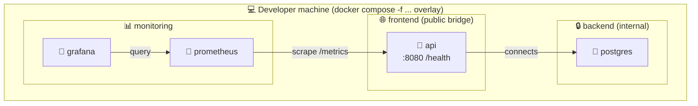

# Observability stack (local only)

Local metrics, dashboards, and container health checks for the GameAPI backend.

## Scope and non-goals

- Local development only.
- Never deployed to Render.
- Metrics only: no logs, no traces.
- Not included in the default Docker Compose stack.

## Topology



The existing stack still exposes the API on the `frontend` network and keeps PostgreSQL isolated on the `backend` network. The monitoring stack is deliberately separated onto a dedicated `monitoring` bridge network, with Grafana bound to `127.0.0.1` only.

## How to enable and disable

```bash
make monitoring-up
make monitoring-down
make monitoring-logs
```

To remove the monitoring data volumes and wipe the local history:

```bash
make monitoring-clean
```

## Files in this directory

- `README.md` — overview and commands for the monitoring stack.
- `SECURITY.md` — threat model, trust boundaries, and hardening notes.
- `prometheus/` — Prometheus configuration and scrape targets.
- `grafana/provisioning/` — Grafana datasource and dashboard provisioning.
- `dashboards/` — versioned dashboard JSONs (empty for now).

## Environment variables

The file `.env.monitoring.example` is the source of truth for the local monitoring stack. Copy it to `.env.monitoring` and fill in the values before use.

| Variable | Purpose | Default | Consumed by |
|---|---|---:|---|
| `GRAFANA_ADMIN_USER` | Local Grafana admin username. | `admin` | Grafana |
| `GRAFANA_ADMIN_PASSWORD` | Local Grafana admin password. | `change-me-before-running` | Grafana |
| `PROMETHEUS_RETENTION` | Prometheus time-series retention window. | `7d` | Prometheus |
| `PROMETHEUS_SCRAPE_INTERVAL` | Shared scrape interval for jobs. This is currently informational only; the effective interval is hard-coded in `prometheus.yml`. | `15s` | Prometheus |
| `BLACKBOX_API_HEALTH_URL` | Health endpoint used by the blackbox exporter checks. | `http://api:8080/health` | blackbox-exporter in Prompt 4 |

## Roadmap of the remaining prompts

- ✅ Prompt 1 — Scaffolding.
- ✅ Prompt 2 — API instrumentation (`METRICS_ENABLED` gating).
- ✅ Prompt 3 — Prometheus + Grafana with provisioning.
- ⏳ Prompt 4 — Exporters (`cAdvisor`, `postgres-exporter`, `blackbox-exporter`).
- ⏳ Prompt 5 — Dashboards and reporting assets.
- ⏳ Prompt 6 — Optional packet-capture profile.

## First-run checklist

1. `cp .env.monitoring.example .env.monitoring`
2. Edit `.env.monitoring` and set a strong `GRAFANA_ADMIN_PASSWORD`. Use `openssl rand -base64 24` as a quick generator.
3. `make monitoring-up`
4. Open `http://localhost:3001` and log in.
5. Verify the Prometheus datasource is present under **Connections → Data sources**.
6. Verify the `gameapi-api` scrape target is **UP** under **Status → Targets** inside Prometheus.

## Troubleshooting

### Grafana does not start

Check that `.env.monitoring` exists and that `GRAFANA_ADMIN_PASSWORD` is set. The Compose file uses `${GRAFANA_ADMIN_PASSWORD:?...}` to fail fast instead of starting with an empty or default password.

### Prometheus has no data

Confirm the API container started with `METRICS_ENABLED=true` in the overlay and that the API exposes `/metrics` on `http://api:8080/metrics` from inside the monitoring network.

### Port 3001 is already in use

Stop the conflicting service or change the bind address locally while keeping the public exposure restricted to `127.0.0.1`.

## Notes

- The monitoring stack is intentionally local-only.
- It is never deployed to Render and is not referenced from `render.yaml`.
- Prometheus has no published port. It is only reachable from the `monitoring` network.
- Grafana is intentionally bound to `127.0.0.1:3001` and is the only monitoring service with a public loopback port.
