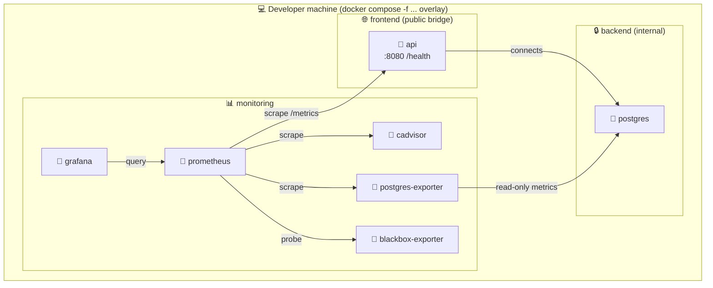

# Observability stack (local only)

Local metrics, dashboards, and container health checks for the GameAPI backend, with an opt-in API packet capture.

## Scope and non-goals

- Local development only.
- Never deployed to Render.
- Metrics by default; packet capture is opt-in.
- Not included in the default Docker Compose stack.

## Topology



The existing stack still exposes the API on the `frontend` network and keeps PostgreSQL isolated on the `backend` network. The monitoring stack is deliberately separated onto a dedicated `monitoring` bridge network, with Grafana bound to `127.0.0.1` only.

## How to enable and disable

```bash
make monitoring-up
make monitoring-down
make monitoring-logs
```

To remove the monitoring data volumes and wipe the local history:

```bash
make monitoring-clean
```

This removes only the Prometheus and Grafana volumes; PostgreSQL data is preserved.

## Optional API packet capture

The capture service is not part of the default monitoring stack. It uses the `capture` Compose profile and shares the API container's network namespace to capture traffic on port 8080 only.

Start the monitoring stack and API first, then start the capture in a separate terminal:

```bash
make monitoring-up
make monitoring-capture
```

Generate API requests from another terminal. Stop the capture with Ctrl+C, then export the pcap:

```bash
curl -i http://localhost:8080/health
make monitoring-capture-export
```

The file is saved as `capture/api.pcap`, which is gitignored. Open it in Wireshark to inspect the capture. Packet captures may contain personally identifiable information, request and response bodies, authorization headers, JWTs, or other credentials. Treat them as secrets: do not commit or share the file. Remove the exported file and clear the capture container and named volume when finished:

```bash
rm capture/api.pcap
make monitoring-capture-clean
```

`make monitoring-capture-logs` follows tcpdump's packet summary output. `make monitoring-capture-clean` removes the capture container and pcap volume, but does not remove the exported local file.

## Files in this directory

- `README.md` — overview and commands for the monitoring stack.
- `SECURITY.md` — threat model, trust boundaries, and hardening notes.
- `DEMO.md` — step-by-step script for the class presentation.
- `prometheus/` — Prometheus configuration and scrape targets.
- `grafana/provisioning/datasources/` — Grafana datasource provisioning.
- `grafana/provisioning/dashboards/` — Grafana dashboard provisioning and dashboard JSON files.
- `blackbox/` — blackbox-exporter probe configuration.

## Environment variables

The file `.env.monitoring.example` is the source of truth for the local monitoring stack. Copy it to `.env.monitoring` and fill in the values before use.

| Variable | Purpose | Default | Consumed by |
|---|---|---:|---|
| `GRAFANA_ADMIN_USER` | Local Grafana admin username. | `admin` | Grafana |
| `GRAFANA_ADMIN_PASSWORD` | Local Grafana admin password. | `change-me-before-running` | Grafana |
| `PROMETHEUS_RETENTION` | Prometheus time-series retention window. | `7d` | Prometheus |
| `PROMETHEUS_SCRAPE_INTERVAL` | Shared scrape interval for jobs. This is currently informational only; the effective interval is hard-coded in `prometheus.yml`. | `15s` | Prometheus |
| `BLACKBOX_API_HEALTH_URL` | Health endpoint used by the blackbox exporter checks. | `http://api:8080/health` | blackbox-exporter in Prompt 4 |

## Dashboards

| Dashboard | UID | Panels | What it answers |
|---|---|---|---|
| GameAPI Overview | `gameapi-overview` | Request rate, error rate, latency percentiles, status distribution, uptime | "How is the API behaving right now?" |
| GameAPI Containers | `gameapi-containers` | CPU, memory, network I/O, filesystem for available cAdvisor cgroups | "What resource activity does cAdvisor expose?" |
| GameAPI PostgreSQL | `gameapi-postgres` | Connections, transactions, locks, cache hit ratio, live tuple counts | "Is the database healthy?" |
| GameAPI Health | `gameapi-blackbox` | Probe status, duration, HTTP status, phase breakdown | "Is the API reachable from outside?" |

All four dashboards are provisioned automatically. Editing a dashboard in the UI does **not** persist; edit its JSON file and wait 30 seconds for the provisioning interval.

The live cAdvisor configuration has no Docker socket and currently exposes only the host root cgroup (`id="/"`), rather than individual container labels. The Containers dashboard reflects that available data and does not claim per-container measurements.

## Roadmap of the remaining prompts

- ✅ Prompt 1 — Scaffolding.
- ✅ Prompt 2 — API instrumentation (`METRICS_ENABLED` gating).
- ✅ Prompt 3 — Prometheus + Grafana with provisioning.
- ✅ Prompt 4 — Exporters (`cAdvisor`, `postgres-exporter`, `blackbox-exporter`).
- ✅ Prompt 5 — Dashboards and demo assets.
- ✅ Prompt 6 — Optional packet-capture profile.

## First-run checklist

1. `cp .env.monitoring.example .env.monitoring`
2. Edit `.env.monitoring` and set a strong `GRAFANA_ADMIN_PASSWORD`. Use `openssl rand -base64 24` as a quick generator.
3. `make monitoring-up`
4. Open `http://localhost:3001` and log in.
5. Verify the Prometheus datasource is present under **Connections → Data sources**.
6. Verify **Status → Targets** shows four jobs, all **UP**: `gameapi-api`, `cadvisor`, `postgres`, and `blackbox`.
7. Open **Dashboards → GameAPI** and confirm the four provisioned dashboards are listed.

## Scrape targets

| Job | Target | Metrics |
|---|---|---|
| `gameapi-api` | `api:8080/metrics` | HTTP request rate, latency, and status codes |
| `cadvisor` | `cadvisor:8080/metrics` | Container CPU, memory, network, and filesystem |
| `postgres` | `postgres-exporter:9187/metrics` | Connections, locks, table sizes, and index usage |
| `blackbox` | `blackbox-exporter:9115/probe?target=http://api:8080/health` | Uptime, response time, and HTTP status |

cAdvisor runs with a documented security deviation: it has no Docker socket, but uses `SYS_PTRACE`, a writable container root filesystem, and read-only host mounts including `/var/lib/docker`. See [SECURITY.md](./SECURITY.md) for the rationale and limitations.

## Troubleshooting

### Grafana does not start

Check that `.env.monitoring` exists and that `GRAFANA_ADMIN_PASSWORD` is set. The Compose file uses `${GRAFANA_ADMIN_PASSWORD:?...}` to fail fast instead of starting with an empty or default password.

### Prometheus has no data

Confirm the API container started with `METRICS_ENABLED=true` in the overlay and that the API exposes `/metrics` on `http://api:8080/metrics` from inside the monitoring network.

If the `cadvisor` target is **DOWN**, inspect its logs with `docker compose -f docker-compose.yml -f docker-compose.monitoring.yml --env-file .env.monitoring logs cadvisor`. A missing `/dev/kmsg` device on the host is a common cause.

### Port 3001 is already in use

Stop the conflicting service or change the bind address locally while keeping the public exposure restricted to `127.0.0.1`.

### Capture cannot join the API network namespace

Start the API with `make monitoring-up` before running `make monitoring-capture`. The capture service uses `network_mode: service:api`, so it requires the API container to be running and cannot be independently attached to a network.

## Notes

- The monitoring stack is intentionally local-only.
- It is never deployed to Render and is not referenced from `render.yaml`.
- Prometheus has no published port. It is only reachable from the `monitoring` network.
- Grafana is intentionally bound to `127.0.0.1:3001` and is the only monitoring service with a public loopback port.
- The opt-in capture service shares only the API container's network namespace and filters for port 8080; it does not capture host traffic.
