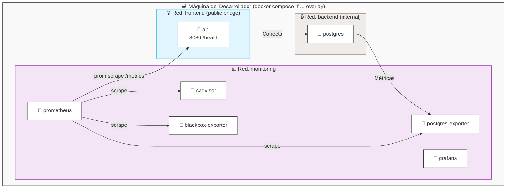

# Observability stack (local only)

Local metrics, dashboards, and container health checks for the GameAPI backend.

## Scope and non-goals

- Local development only.
- Never deployed to Render.
- Metrics only: no logs, no traces.
- Not included in the default Docker Compose stack.

## Topology



The existing stack still exposes the API on the `frontend` network and keeps PostgreSQL isolated on the `backend` network. The monitoring stack is deliberately separated onto a dedicated `monitoring` bridge network, with Grafana bound to `127.0.0.1` only.

## How to enable and disable

```bash
docker compose -f docker-compose.yml -f docker-compose.monitoring.yml up -d
docker compose -f docker-compose.yml -f docker-compose.monitoring.yml down
```

To remove the monitoring data volumes and wipe the local history:

```bash
docker compose down -v
```

## Files in this directory

- `README.md` — overview and commands for the monitoring stack.
- `SECURITY.md` — threat model, trust boundaries, and hardening notes.
- `dashboards/` — versioned Grafana dashboards (empty for now).

## Environment variables

The file `.env.monitoring.example` is the source of truth for the local monitoring stack. Copy it to `.env.monitoring` and fill in the values before use.

| Variable                     | Purpose                                           |                    Default | Consumed by                   |
|------------------------------|---------------------------------------------------|---------------------------:|-------------------------------|
| `GRAFANA_ADMIN_USER`         | Local Grafana admin username.                     |                    `admin` | Grafana in Prompt 3           |
| `GRAFANA_ADMIN_PASSWORD`     | Local Grafana admin password.                     | `change-me-before-running` | Grafana in Prompt 3           |
| `PROMETHEUS_RETENTION`       | Prometheus time-series retention window.          |                       `7d` | Prometheus in Prompt 3        |
| `PROMETHEUS_SCRAPE_INTERVAL` | Shared scrape interval for jobs.                  |                      `15s` | Prometheus in Prompt 3        |
| `BLACKBOX_API_HEALTH_URL`    | Health endpoint used by blackbox exporter checks. |   `http://api:8080/health` | blackbox-exporter in Prompt 5 |

## Roadmap of the remaining prompts

- Prompt 2 — API instrumentation and health/metrics exposure.
- Prompt 3 — Prometheus service and scrape configuration.
- Prompt 4 — Grafana service, dashboards, and provisioning.
- Prompt 5 — Exporters for cAdvisor, PostgreSQL, and blackbox.
- Prompt 6 — Optional packet-capture profile for deeper network analysis.

## Troubleshooting

### Grafana does not start

Placeholder text for the Grafana startup checklist when the service is added in Prompt 3.

### Prometheus has no data

Placeholder text for scrape validation and target health checks when Prometheus is added in Prompt 3.

### Port 3001 is already in use

Placeholder text for local port conflict resolution and how to choose an alternate bind address while keeping the stack local-only.

## Notes

- The monitoring stack is intentionally local-only.
- It is never deployed to Render and is not referenced from `render.yaml`.
- Service definitions are intentionally not included in this overlay yet. They are added in later prompts.
